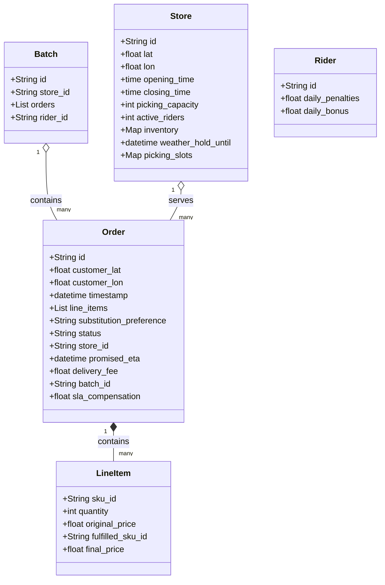
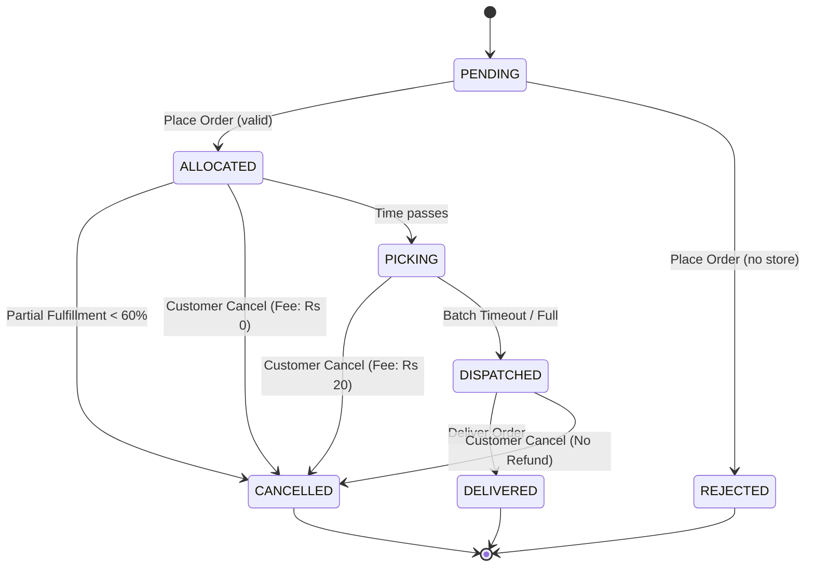

# Dark-Store Order Allocation Engine
## Design Document & Implementation Report

### Overview
This document outlines the architecture and implementation of the command-line driven order allocation engine for a quick-commerce platform. It handles store selection, substitutions, batching, and SLA computations based on 10-minute SLAs.

### Business Rule Register
*   **BR-01 (Serviceability):** A store can serve an order only if straight-line distance <= 3.0 km and the order time is inside store hours. Haversine formula is used, rounded to 2 decimals.
*   **BR-02 (Store Choice):** Among serviceable stores, pick the one with 100% stock first; tie-break by lowest distance, then by lowest load in the current 10-min picking slot; if none has 100% stock pick highest line-fill percent.
*   **BR-03 (Picking Capacity):** Each store accepts at most its capacity (default 12 orders) per 10-min slot starting from the order time; when full the order rolls into the next slot.
*   **BR-04 (ETA):** Promised ETA = 2 min pick + 1.5 min per km (rounded up) + 2 min per earlier drop in the same batch. Orders > 10 min ETA without slow delivery opt-in are tagged `DELAYED_PROMISE`.
*   **BR-05 (Substitution):** When a line is short, ALLOW permits any SKU in the same category within +15% price; SIMILAR_ONLY permits only the same brand. Customer pays the original or lower price.
*   **BR-06 (Partial Fulfillment):** Evaluated after substitutions. If the fulfilled value drops below 60% of the original order value, the order is cancelled before dispatch with a full refund and no delivery fee, and inventory is restored.
*   **BR-07 (Delivery Fee):** Rs 0 for order value >= Rs 199 after substitutions, else Rs 25; surge +Rs 15 when a store's active riders < 3 at allocation time.
*   **BR-08 (Batching):** A rider may carry up to 3 orders within 1.0 km drop points and ETA difference <= 4 min. Dispatches when full or 3 min after picking.
*   **BR-09 (SLA Compensation):** Actual delivery later than promised ETA by 5–10 min credits Rs 25; > 10 min credits Rs 50 + free delivery coupon. Exceptions apply for `DELAYED_PROMISE`.
*   **BR-10 (Rider Penalty):** Late on 2+ orders in a batch loses the Rs 20 batch bonus; late by > 15 min gets Rs 30 deduction (capped at Rs 90/day).
*   **BR-11 (Weather Hold):** Stops new allocations for 20 min; extends ETA of already allocated orders by 10 min.
*   **BR-12 (Cancellation):** Customer cancellation before picking is free; during picking costs Rs 20; after dispatch no refund (except non-ALLOW substitutions).

### Class Diagram

### State Diagram (Order)

### Glossary
*   **Haversine Distance**: Straight-line geographic distance calculated using latitude and longitude.
*   **SKU**: Stock Keeping Unit, a distinct item for sale.
*   **Picking Slot**: A 10-minute window assigned to an order for picking and packing at the store.
*   **DELAYED_PROMISE**: A flag indicating the initial ETA promised to the customer was greater than 10 minutes.
*   **SLA**: Service Level Agreement.

### Recent Fixes
*   **Time-Advancement/Event Loop:** Implemented a mechanism in `engine.py` to advance a global clock based on incoming command timestamps, ensuring timeouts (like batch dispatch) trigger correctly.
*   **Inventory Leak Fix:** Ensure inventory is restored if an order is cancelled due to falling below the 60% value threshold during partial fulfillment.
*   **Rider Penalty Calculation:** Refactored penalty computation to wait until all orders in a batch are delivered, correctly evaluating if 2+ orders were late in the same batch.
*   **Cancellation State Logic:** Accurately transition orders from `ALLOCATED` to `PICKING` as time advances, ensuring cancellation fees are accurately applied based on the picking state.
